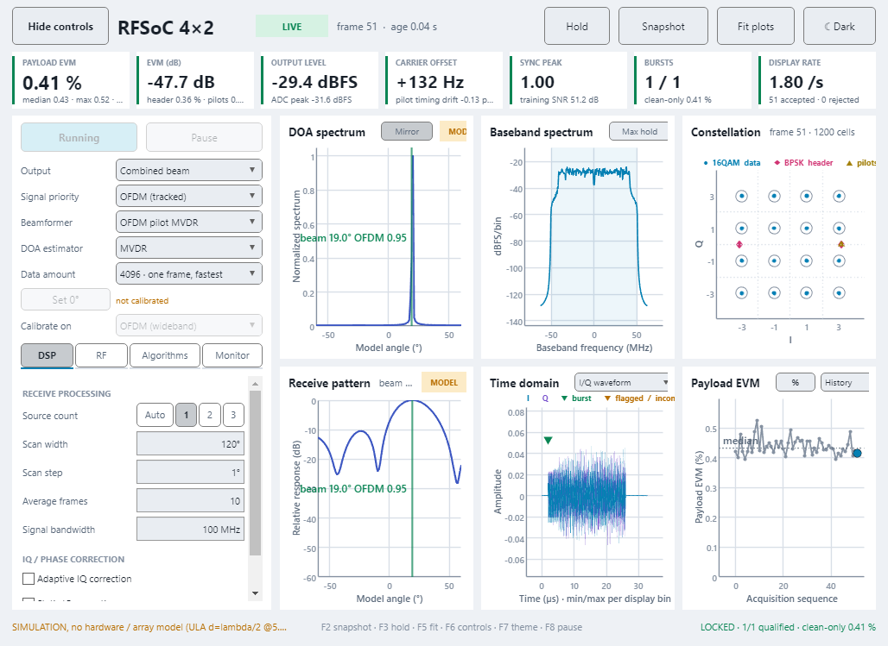

# RFSoC 4x2 beamformer

A four-element over-the-air receive beamformer for the AMD RFSoC 4x2 board. The
board transmits an OFDM loop from its two DACs and captures four ADC streams from
a patch array. A Windows application estimates the direction of arrival, forms the
beam and demodulates the OFDM. It keeps working while a signal generator jams the
array.



*The default window, here on the built-in simulation (`RFSoCBeamformer.exe demo`), not hardware data.*

## Start

1. Connect the board to the PC with USB. It appears as a network adapter and as a
   drive named **PYNQ-USB**.
2. Once per PC, install the MATLAB Runtime R2026a: run `setup.exe` in
   `PYNQ-USB\MATLAB_Runtime_R2026a_Update_5_win64`. With MATLAB R2026a installed,
   skip this and use `start.cmd` in the next step.
3. Copy `PYNQ-USB\RFSoCBeamformer` to the PC and start `RFSoCBeamformer.exe`.

The application finds the board (USB first, then Ethernet, otherwise it asks for the
address), starts a board session (about 10 s) and opens the window. Closing the
window ends the session and switches the DAC outputs off. The same builds are on
the [Releases](https://github.com/Seguar/rfsoc4x2-beamformer/releases) page;
`RFSoCBeamformer.exe demo` runs without hardware. Options and limits:
[docs/STANDALONE.md](docs/STANDALONE.md).

## The window

From top to bottom:

- **Header:** Hide controls (F6), the session state (`LIVE`, `PAUSED`, `HELD`…), the
  frame number and its age, **Hold** (F3, freezes the plots while the board keeps
  streaming), **Snapshot** (F2, PNG and MAT of the shown frame), **Fit plots** (F5)
  and the theme switch (F7).
- **Readout tiles:** payload EVM in % and in dB, output level, carrier offset,
  preamble sync peak, bursts (qualified / complete) and frames per second over the
  last 5 s.
- **Six plots:** DOA spectrum (**Mirror** button), receive pattern of the applied
  weights, baseband spectrum (**Max hold**), time domain (I/Q waveform, or the phase
  or level of each ADC stream), constellation (16-QAM payload, BPSK header, pilots)
  and payload EVM (history, per subcarrier or per symbol; % or dB). Angles are
  angles of the array model; the array is not calibrated.
- **Controls** on the left. Always visible: Start / Pause (F8), **Output**, **Signal
  priority**, **Beamformer**, **DOA estimator**, **Data amount**, **Set 0°** with
  **Calibrate on**. Below them four pages:
  - **DSP:** Source count (Auto / 1 / 2 / 3), scan width and step, frames averaged,
    signal bandwidth, IQ and phase/power correction.
  - **RF:** ADC and DAC centre frequencies and Nyquist zones, DAC power, DAC/ADC
    sync mode, per-connector converter settings (mixer phase, gain, I/Q phase,
    attenuator, DAC current).
  - **Algorithms:** loading, uncertainty, iterations, mismatch angle and step, IQ
    filter length and step.
  - **Monitor:** level, phase and coherence of each ADC stream with its applied
    weight, session counters, the OFDM profile and an event log.
- **Footer:** the scope of the angles, the function keys and the lock state.

Every frame the board sends is processed; the window redraws at most 10 times a
second. A refused frame clears the current plots and names the reason. Details of
every control: [docs/GUI.md](docs/GUI.md).

### Start-up settings of a hardware session

| Setting | Value |
|---|---|
| Frequency | 5.2 GHz: ADC odd zone, DAC zone measured at every session start ([RF_PROFILES.md](docs/RF_PROFILES.md)) |
| Transmitters | DAC_B and DAC_A, DAC_A mixer phase +20°, DAC peak code 24000, DACs start with each capture (DAC = ADC) |
| FPGA image | `dmasync` (DMA capture, DAC starts synchronised to the RF clock) |
| Output | Combined beam |
| Signal priority | OFDM (tracked): the beam follows the direction that carries the OFDM preamble |
| Beamformer | OFDM pilot MVDR (weights from the preamble and the gaps between bursts) |
| DOA estimator | MVDR, source count 1, scan ±60° in 1° steps, 10 frames averaged |
| Data amount | 4096 samples (one OFDM frame per capture, fastest) |
| Display | Mirror on (angles as the antennas are mounted), light theme |
| Calibration | none: press **Set 0°** with a common feed to align the ADCs |

## How it works

```text
board (RFSoC 4x2, PYNQ)                                     PC (RFSoCBeamformer.exe)
 DAC_B + DAC_A ─► TX patches ~~~ air ~~~ 4 RX patches ─► ADC_D,C,B,A (5 GS/s, NCO)
 capture RAM ─DMA─► capture helper (window alignment) ─► session service
        ─── USB or Ethernet: frames (4011), commands (4012), session (4013) ───►
 controller (stream checks) ─► DOA + beamformer ─► OFDM demodulator ─► window
```

- **Board:** a systemd service ([docs/BOARD_SERVICE.md](docs/BOARD_SERVICE.md))
  starts one session per connection. The capture helper loads the FPGA image,
  synchronises the converters (MTS), plays the reference loop and sends four-stream
  windows. Live commands use a separate socket ([docs/BOARD_CONTROL.md](docs/BOARD_CONTROL.md)).
- **Application:** every window is checked on the host (stream locks, loop wrap,
  sample continuity, window SHA-256). Lock is reported, never a reason to drop a
  frame. The DOA estimators and beamformers come from the `vsa_rfsoc` processing
  functions. The OFDM demodulator follows the pinned VSA setup file:
  64-point FFT at 100 MHz (80 points at the 125 MS/s capture rate), training-based
  frequency offset and channel estimate, pilot phase and timing tracking, EVM over
  every complete burst.

## Repository

| Path | Contents |
|---|---|
| `matlab/standalone` | `RFSoCBeamformer.m` (entry point) and `buildStandalone.m` |
| `matlab/original/app/+origapp` | the application: view, session, controller, board link, DSP, OFDM demodulator |
| `matlab/original/tests` | MATLAB checks; `runSuite.m` runs them all |
| `matlab/+rfsoc` | reviewed beamformer engine |
| `board` | board side: session service, capture helper, control socket, MTS, OLED |
| `tools` | service installer, reference builder, session client, slip scan, USB drive tools |
| `tests` | Python tests, fake board stream and fake session service |

Code map and checks: [matlab/README.md](matlab/README.md).

## Build and test

Python 3.10+ with numpy and scipy:

```sh
LEGACY_SOURCE=<vsa_rfsoc>/Signals/dac_ofdm_f_500.mat python3 -m unittest discover -s tests
```

MATLAB R2025b or R2026a with the Phased Array System Toolbox (the RAB PC and DL ITER
MVDR beamformers also need the Optimization Toolbox); MATLAB Compiler for the application. `legacy_ref125.mat` comes from
`tools/legacy_reference.py`.

```matlab
addpath('matlab/original/tests');
runSuite('<legacy_ref125.mat>','<vsa_rfsoc checkout>','<scratch folder>');
addpath('matlab/standalone');
buildStandalone('<vsa_rfsoc checkout>','<legacy_ref125.mat>','<build folder outside the repository>');
```

Every release also goes onto the board's USB drive (`tools/usb_drive/update_app.py`).

## References

- [vsa_rfsoc](https://github.com/Seguar/vsa_rfsoc): the original MATLAB app, its
  processing functions, the OFDM waveform and the VSA setup file.
- [doa_rfsoc](https://github.com/Seguar/doa_rfsoc): the board's boot overlay
  (`main`) and the DMA-capture FPGA images (`dma-capture`).

Addresses, credentials, calibration files and measurements stay out of this repository.
